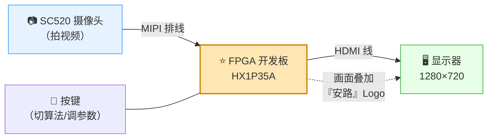

# 01 · 赛题解读：基于安路 PH1P35 的实时数字图像处理系统

> 赛事：全国大学生嵌入式芯片与系统设计竞赛'2026 · FPGA 创新设计赛道
> 选题二：**基于安路 PH1P35 的实时数字图像处理系统**
> 平台：HX1P35A（PH1P35MDG324）· 摄像头 SC520 · 显示 1280×720@60
>
> **本文只讲"题目要求什么、评委看什么"**。怎么干见 [`07_执行路线图.md`](./07_执行路线图.md)，做什么功能见 [`06_情报与呈现方案.md`](./06_情报与呈现方案.md)。

## 一、30 秒看懂这道题



**一句话版**：摄像头把视频送进 FPGA，**FPGA 用我们自己写的图像处理算法改造画面（描边缘/卡通化等），再叠加"安路"Logo，从 HDMI 输出到显示器**——全程实时不卡顿。

**评委看什么**：①采集→处理→显示→贴 Logo 四步是否都稳定做到；②"处理算法"是否**自己写的、与官方例程不同、且更好**；③演示画面是否流畅好看、指标是否有说服力。

## 二、要交付什么（评分视角）

### 2.1 基础 4 条（★必做，及格线）

| # | 要求 | 大白话 | 验收标准 | 我们的状态 |
|---|---|---|---|---|
| B1 | MIPI 摄像头采集 + HDMI 实时显示 | 画面实时传到屏幕 | 稳定、清晰、不撕裂 | ✅ 官方通路已验证 |
| B2 | FPGA 内至少一种图像处理算法 | 在芯片内处理画面 | 处理后画面正确输出 | ✅ 已实现（自研 v4：5×5 均值去噪 + 分段阈值 + 因果迟滞；残雪暂停完善） |
| B3 | 处理后视频稳定输出 | 连续播放不花屏 | 不花屏、不卡顿 | ✅ A3 上板实测：画面实时稳定（连续静置观察记录待补） |
| B4 | OSD 叠加信息 + **"安路"Logo** | 画面角落贴 Logo | Logo 清晰、全程可见 | 🔜 未开始（规划：自研 OSD + 安路 Logo；官方 lab_ex3 已有参照） |

### 2.2 扩展 5 条（**做满才能进决赛**——国一选手原话）

> ⚠️ **2026-10-18 更正**：下表按 2.4「扩展要求」的编号列。但官方 **2.6「评分标准」把扩展重拆成两组且分值不等权**：
> **（一）基础扩展项 2 个**（风格化 / 目标检测）——「完成 2 项且效果良好，可得扩展部分**一半以上**分值」；
> **（二）高阶挑战项 5 个**（多算法切换 / 目标跟踪 / 延迟可视化 / 帧差运动检测 / 自动曝光白平衡）——「完成相同数量时，**高阶挑战项可获得更高分数**」。
> 另外 2.4 的第 (3) 项"结合移动平台实现外部控制"**在 2.6 里没有单列成评分项**，所以不必为它采购电机。
> 按 2.6 排的完整实施方案见 **[`18_扩展与进阶实施方案.md`](18_扩展与进阶实施方案.md)**。下表保留作 2.4 原文对照。

| 官方扩展项 | 我们的计划 | 详见 |
|---|---|---|
| ① 卡通化/风格化 | ✅ 做（边缘 + 颜色量化 + 形态学） | `06` 扩展档 |
| ② 目标检测/识别 | ✅ 做（颜色检测 + 框叠加） | `06` 扩展档 |
| ③ 机电联动（驱动外设） | ⏸ 暂不做（需采购电机，性价比低） | — |
| ④ 性能优化 | ✅ 做（资源/帧率/延时上屏量化） | `06` 扩展档 |
| ⑤ 自主创意 | ✅ 做（多算法切换 + 上板自检状态带） | `06` 扩展档 |

> ⚠️ **重要修正**：早期计划写的是"扩展选 2 个"，国一选手情报明确"**基础与扩展做满方能进入线下（决赛）**"→ 现已改为**扩展做满**（见 `06` 三档功能清单）。

### 2.3 三条红线（碰了直接出局/扣大分）

1. ⚠️ **提交的图像处理算法不能与官方例程相同**（官方用"固定阈值 Sobel 边缘检测 阈值 80"；我们 v4 用"**5×5 均值去噪 + 均值梯度 + 分段自适应阈值 + 因果迟滞**"）
2. ⚠️ **必须用 TD 6.2.1**（高版本工程评审打不开）
3. ⚠️ 外扩电路板**不得含非安路 FPGA**（我们基本不外扩，无风险）

## 三、我们的技术路线基调（差异化基点）

```
官方例程：固定阈值 Sobel（阈值 80 写死）  ──照抄即违规──> ❌
我们做的：自适应阈值边缘检测（v4：5×5 均值去噪 + 均值梯度 + 分段阈值 + 因果迟滞）
          ──同族但明显更强──> ✅ 主算法（B2）
          ├─ 卡通化（边缘 + 颜色量化）              → 扩展①
          ├─ 颜色目标检测 + 框叠加                  → 扩展②
          └─ 多算法切换 + 性能指标上屏              → 扩展④⑤
```

**为什么这样选**：①边缘检测是题目点名的基础算法，满足 B2；②我们改变的是**判决机制**（阈值随局部亮度分段自适应 + 5×5 均值去噪 + 弱边缘靠连通性保留），与官方"拍脑袋定一个阈值"是本质不同；③卡通化与目标检测**复用同一套梯度/行缓存结构**，工程量最省。

## 四、全链路骨架（五棒，所有人都要懂）

```
①采集(摄像头/MIPI) → ②缓存(ISP+DDR) → ③算法(自研处理) → ④叠加(OSD/Logo) → ⑤显示(HDMI/TMDS)
```

任何人做任何模块，都要说清"**我的活在第五棒、上游给什么格式、下游要什么格式**"。

## 五、文档与记忆机制

- **文档地图**：见 [`00_阅读指南.md`](./00_阅读指南.md)
- **长期事实与坑**：`memory\MEMORY.md`（关键参数、已踩坑、编写规范、路线调整）
- **进度与数据**：`memory\PROGRESS.md`（每阶段成果、资源/时序数据）
- 规则：每阶段结束、每踩一个大坑，都会主动写入记忆；交付前自检"是否偏离基础 4 条 + 红线"。
