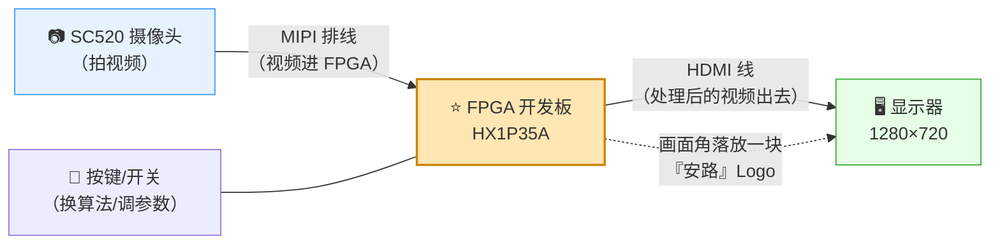

# 赛题二 · 实战路线图（4 周冲刺版）

> 赛事：全国大学生嵌入式芯片与系统设计竞赛'2026 · FPGA 创新设计赛道  
> 选题二：**基于安路 PH1P35 的实时数字图像处理系统**  
> 平台：HX1P35A（PH1P35MDG324）· 摄像头 SC520 · 显示器 1280×720  
> 本图只讲"**要做什么、分几步、谁干什么**"，不涉及具体技术；技术细节会在每一阶段推进时单独展开。

---

## 0. 30 秒看懂这道题（先建立整体感）



**一句话版**：摄像头把视频送进 FPGA，**FPGA 用我们自己写的"图像处理算法"把画面改造一遍（比如描出边缘/变成卡通），再叠加上"安路"Logo，从 HDMI 输出到显示器**。全部实时、不卡顿。

**评委看什么**：①这四步（采集→处理→显示→贴Logo）是否都稳定做到；②你的"处理算法"是否**自己写的、和官方例程不一样、还更好**；③演示时画面是否流畅好看。

---

## 1. 我们要交付什么（评分视角，全队对齐）

### 1.1 基础 4 条（★必做，是及格线）

| #  | 要做什么                    | 大白话            | 验收标准         |
| -- | ----------------------- | -------------- | ------------ |
| B1 | MIPI 摄像头采集 + HDMI 实时显示  | 摄像头画面实时传到屏幕    | 画面稳定、清晰、不撕裂  |
| B2 | FPGA 内至少一种图像处理算法        | 在"芯片内"给画面做处理   | 处理后画面正确输出    |
| B3 | 处理后视频稳定输出               | 处理过的画面连续播放     | 不花屏、不卡顿      |
| B4 | OSD 叠加信息 + **"安路"Logo** | 画面角落贴 Logo 和文字 | Logo 清晰、全程可见 |

### 1.2 扩展项（选做，加分）——我们**选 2 个**

| 我们做            | 对应官方  | 为什么选它                   |
| -------------- | ----- | ----------------------- |
| ⭐ 卡通化（风格化）     | 扩展(1) | 视觉冲击最强，答辩演示"一眼好看"       |
| 颜色/形状目标检测 + 画框 | 扩展(2) | 规则级可实现（无需神经网络芯片），演示互动感强 |
| 性能优化（降资源/提实时）  | 扩展(4) | 贯穿始终，报告里能量化，**顺手就做**    |

> 说明：扩展(3)"驱动小车/外设"需要额外采购电机硬件，4 周冲刺先**不碰**；进阶加分项（多算法切换等）若时间富余再上，不影响及格。

### 1.3 三条红线（碰了直接出局/扣大分）

1. ⚠️ **提交的图像处理算法不能和官方例程一样**（例程用的是"固定阈值 Sobel 边缘检测"，我们改做"自适应阈值边缘检测"，见 §2）。
2. ⚠️ **必须用 TD 6.2.1 开发**（高版本工程评审打不开）。
3. ⚠️ 外扩电路板**不得含非安路 FPGA**（我们基本不外扩，无风险）。

---

## 2. 我们的技术路线（一句话定方向）

```
官方例程：固定阈值 Sobel 边缘检测  ──照抄就是违规──> ❌ 不能用
我们做的：自适应阈值边缘检测       ──同族但明显更强──> ✅ 主算法
          +  卡通化（边缘+颜色量化）            ✅ 扩展①
          +  颜色/形状检测 + 画框               ✅ 扩展②（可选）
```

**为什么这么选**：

- "边缘检测"是赛题目录里点名的基础算法，做透它**既满足 B2，又天然区别于例程**（例程是拍脑袋定一个阈值，我们是根据画面亮度**自动算阈值**，强光暗光都稳）。
- 卡通化和目标检测**都能复用"边缘检测"这套东西**，工程上不重复造轮子——最适合 4 周冲刺。

---

## 3. 四周冲刺路线（分阶段 · 每阶段含注意点）

> 原则：**先出图，再谈算法；先仿真做对，再上板跑通。** 每阶段的"注意点"这里是**粗略概括**，推进到该阶段时再给具体清单。


### 第 1 周 · 通路打通（P0 + P1）

| 项           | 内容                                                                                                    |
| ----------- | ----------------------------------------------------------------------------------------------------- |
| 目标          | 板子能跑官方例程**出画面**；同时搭出"不用摄像头也能显示彩条"的地基                                                                  |
| 交付          | ✅ 官方 SC520 例程烧写成功、画面实时显示；✅ 自研彩条测试图显示成功                                                                |
| 验收          | 显示器稳定显示 720p 画面 ≥10 分钟不花屏                                                                             |
| **注意点（粗略）** | ①**用 SC520 版例程**（不用 SC500 版），上板前肉眼看摄像头丝印确认；②显示器和 HDMI 线一定要买到（720p@60）；③先别碰算法，先把"从摄像头到屏幕"整条链跑通，出问题才好定位 |

### 第 2 周 · 算法攻关（P2 + P3）

| 项           | 内容                                                                                          |
| ----------- | ------------------------------------------------------------------------------------------- |
| 目标          | 自研边缘检测算法在**仿真里做对**，再插进通路**实时跑通**                                                            |
| 交付          | ✅ 算法 IP（自适应阈值边缘检测）；✅ Python 黄金模型比对 0 误差；✅ 上板实时出边缘图                                          |
| 验收          | 用"已知彩条图"输入 → 算法输出与手算/脚本结果**逐像素一致**；上板画面正确                                                   |
| **注意点（粗略）** | ①**必须先写 Python 参考模型 + 自动比对**，别只靠"看着像"；②测试用例要覆盖全黑/全白/细线/斜线等极端图；③自检脚本要有"总量校验"（否则算法完全不动也会误报通过） |

### 第 3 周 · OSD + 交互 + 扩展（P4 + P5 + P6）

| 项           | 内容                                                                  |
| ----------- | ------------------------------------------------------------------- |
| 目标          | 叠加"安路"Logo 和文字；按键能换算法/调参数；做出 1~2 个扩展                                |
| 交付          | ✅ 自制 Logo + 半透明叠加；✅ 按键实时调阈值；✅ 卡通化（+可选目标检测画框）                        |
| 验收          | Logo 全程可见；按键调参数画面立即变化；卡通化效果明显                                       |
| **注意点（粗略）** | ①Logo 放**固定显眼位置、全程可见**（评审一定会找）；②扩展"够炫但别贪多"，先保卡通化做稳；③按键消抖别忘，否则一按跳好几下 |

### 第 4 周 · 收敛交付（P7）

| 项           | 内容                                                                                      |
| ----------- | --------------------------------------------------------------------------------------- |
| 目标          | 稳定性测试 + 写文档 + 录视频 + 做 PPT                                                               |
| 交付          | ✅ 设计报告 + 演示视频 + 答辩 PPT + 复现说明 + 源码工程                                                    |
| 验收          | 连续运行 ≥4 小时无异常；重启后正常；自查清单全打勾                                                             |
| **注意点（粗略）** | ①**量化指标**：帧率、资源占用、连续运行时长都要写成数字；②过一遍"不违规"自检（算法≠例程、TD 6.2.1、Logo 在）；③录视频时演示"实时调阈值"这类互动，加分 |

---

## 4. 两种打法（用户特别要求：单人版 + 三人版）

### 4.0 先记住这条链路（所有人都要懂，是"整体在干嘛"的骨架）

```
①采集(摄像头) → ②缓存(暂存) → ③算法(改造画面) → ④叠加(贴Logo) → ⑤显示(HDMI)
```

任何人做任何模块，都要知道自己的活处在**这条链的第几棒**、上游给什么、下游拿什么。

### 4.1 打法 A：一个人独立跑全流程（串行，理解全貌用）

```
P0 基线出图 → P1 彩条地基 → P2 算法仿真 → P3 算法上板 → P4 OSD → P5 交互 → P6 扩展 → P7 交付
```

- 特点：按依赖顺序**一件一件做**，最终**每个环节都亲手通过**，全链路无盲点。
- 适合：自己摸清整体怎么做；也是三人里"有基础那位"该先走一遍的路径。
- 代价：串行慢，4 周单人很紧张 → **扩展只做 1 个（卡通化），目标精简为"稳基础 + 1 扩展"**。

### 4.2 打法 B：三人并行分工（推荐，各管一段但共享同一张图）

```mermaid
flowchart TB
    subgraph A["👷 A（有Verilog+上板经验）· 通路负责人"]
        A1["P0 基线出图"] --> A2["P1 彩条地基"] --> A3["P3 集成上板 + 调时序"]
    end
    subgraph B["👩‍💻 B（新手·学习力强）· 算法负责人"]
        B1["P2 算法仿真"] --> B2["Python 黄金模型"] --> B3["适配算法接口给A"]
    end
    subgraph C["👨‍🎨 C（新手·学习力强）· 显示/OSD + 文档"]
        C1["生成自制Logo素材"] --> C2["OSD叠加模块"] --> C3["文档/记录/测试清单"]
    end
    A3 <-->|"标准接口：96bit像素流"| B3
    A3 <-->|"OSD 插在显示链"| C2
    style A fill:#e6f2ff,stroke:#3399ff
    style B fill:#ffe6b3,stroke:#cc8400
    style C fill:#f2e6ff,stroke:#9933cc
```



**三人各干什么 + 如何避免对接盲点：**

| 人           | 主要负责                        | 独立可推进           | 与谁对接（契约）                       |
| ----------- | --------------------------- | --------------- | ------------------------------ |
| A 通路        | P0/P1/P3（板子上的活、驱动、上板调试）     | P0、P1 可立即开工     | 接 B 的算法 IP、接 C 的 OSD，统一收口到顶层   |
| B 算法        | P2（仿真 + 黄金模型，**完全不用板子也能干**） | P2 全线独立         | 交付给 A 一个"标准接口"的算法模块 + 已仿真通过的证据 |
| C 显示/OSD+文档 | P4 OSD 素材与模块 + 全部文档/记录      | Logo 素材、文档可立即开工 | 交付给 A 一个 OSD 模块，插在显示链上         |

**防盲点三条规矩**：

1. **开工前 3 人先把 §4.0 那条链路背下来**，每个人汇报时都要说清"我在第几棒"。
2. **接口先约定**：任何跨模块交接，先约定"输入什么格式、输出什么格式"（B 和 C 都要按 A 给定的统一接口做），再各自开发。
3. **每天对一次 §4.0 的进度**：谁卡住了，影响的是链路哪一棒，全队立刻知道。

> 💡 **给新手的两句定心丸**：Verilog 不是障碍——你们有 AI + 现成例程可参照，难点在"理解数据怎么流"，不在"背语法"。所以先做"读懂 §0 的图"，再动手。

---

## 5. 文件存放规划（E 盘，简版）

详见 [`02_文件存放规划.md`](./02_文件存放规划.md)。一句话：**新产物统一进 `E:\fpga\contest_s2\`（docs/src/sim/assets/delivery/memory），官方资料只读，最终提交物放 `delivery\`。**

## 6. 记忆机制（错误与关键点怎么沉淀）

- **位置**：`E:\fpga\contest_s2\memory\`（`MEMORY.md` = 长期关键事实 + 已踩坑清单；推进中滚动更新）。
- **记什么**：①踩过的坑（原因+解法）②关键参数/结论③重要转折决策（如"摄像头是 SC520"这个纠错）。
- **什么时候更新**：每阶段结束、每踩一个大坑，我都会**主动写进记忆**，并在我输出前自检"有没有偏离 4 条基础 + 既定打法"。

## 7. 现在立刻要做的三件事（不用等，今天就能动）

1. **A 同学**：把摄像头插上板子前，先**肉眼确认型号丝印是不是 SC520**，然后照[上板检查指南]接线。
2. **全体**：确认显示器 + HDMI 1.4 线到货（这是第 1 周的硬前提）。
3. **B 同学**：可以先开始**看 Python 图像处理基础**（为第 2 周的黄金模型做准备），**不需要板子**。

---

*下一步：我们从 P0 开始推进——我会先带你确认 SC520 例程的编译与烧写步骤，并在推进前先到 GitHub 检索可借鉴的开源项目。*
